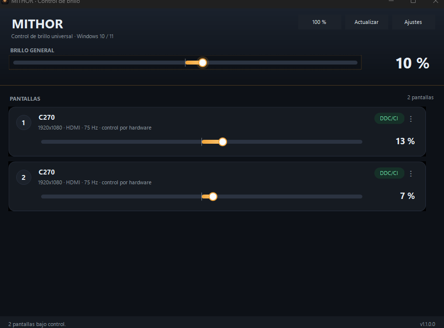
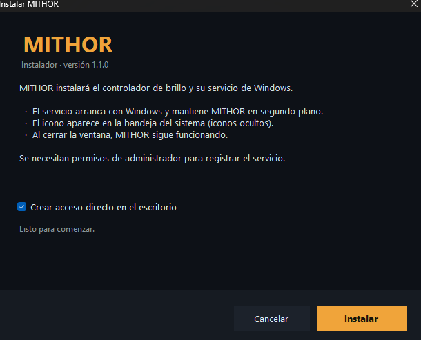
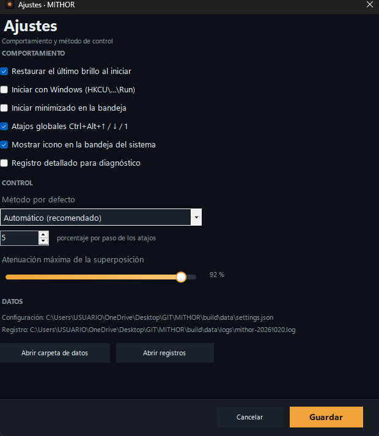
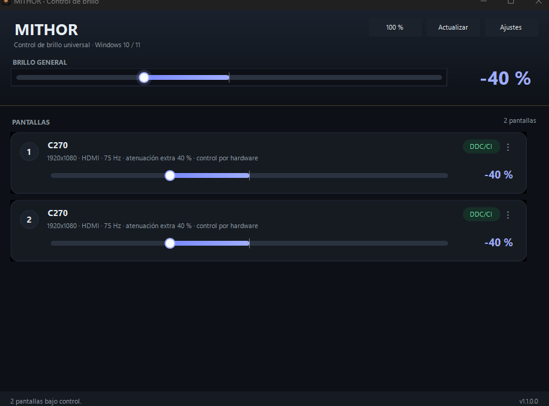

# MITHOR

**Control de brillo universal para Windows**, con instalador, servicio en segundo plano e icono en la
bandeja del sistema. El núcleo está preparado para dar el salto a Linux.

MITHOR detecta todas las pantallas y elige automáticamente el mejor método de control para cada una:
DDC/CI por hardware, WMI para paneles integrados, gamma por software o una capa de atenuación universal.
Además permite **bajar el brillo por debajo del mínimo del monitor**, algo que el hardware por sí solo no
permite.



---

## Novedades de la versión 1.1

- **Instalador** `MITHOR-Setup.exe` con elevación de permisos, accesos directos y desinstalación.
- **Servicio de Windows** que arranca con el equipo y mantiene MITHOR en segundo plano.
- **Brillo negativo** (−100…100): por debajo de 0 se aplica atenuación extra por software.
- **Icono en los iconos ocultos** de la bandeja, con menú rápido, presets y modo oscuro.
- Cierre de la ventana = MITHOR sigue funcionando; el servicio lo relanza si se cierra.

## Instalación

1. Ejecuta **`dist\MITHOR-Setup.exe`** (doble clic).
2. Acepta el aviso de **Control de cuentas de usuario** (se necesitan permisos de administrador para
   registrar el servicio).
3. Pulsa **Instalar**. El proceso copia los archivos en `C:\Program Files\MITHOR`, registra el servicio
   `MITHOR`, crea el acceso directo del menú Inicio y muestra el icono en la bandeja.



La instalación también se puede automatizar:

```powershell
# Instalación silenciosa (sin interfaz)
.\MITHOR-Setup.exe --quiet

# Sin acceso directo en el escritorio
.\MITHOR-Setup.exe --nodesktop

# Desinstalación silenciosa
.\MITHOR-Setup.exe --uninstall --quiet
```

Al instalar se registra una entrada en **Agregar o quitar programas** para poder desinstalar MITHOR
como cualquier otra aplicación.

### Instalación sin servicio (portátil)

`MITHOR.exe` funciona también sin instalar: no requiere administrador, guarda sus datos en
`%LOCALAPPDATA%\MITHOR` (o en una carpeta `datos` junto al ejecutable si no hay permisos) y, al cerrar
la ventana, se queda en la bandeja. El servicio es lo que aporta el arranque automático y la supervisión.

## Servicio y segundo plano

El servicio `MITHOR` (cuenta LocalSystem, inicio automático) se encarga de:

- arrancar con Windows;
- detectar la sesión activa (incluida una sesión RDP) y lanzar `MITHOR.exe --agent` dentro de ella;
- relanzar el agente si se cierra o se bloquea;
- reiniciarse automáticamente si falla (5 s, 15 s y 60 s).

El agente es la aplicación normal: muestra el icono en la bandeja, controla el brillo y abre la ventana
cuando haces clic en el icono. **Cerrar la ventana no cierra MITHOR**: solo la oculta.

Para salir de verdad, usa **Salir de MITHOR…** en el menú del icono. Si el servicio está activo, MITHOR
pedirá permisos para detenerlo y así no volver a arrancarse.

> El servicio se puede ver y controlar desde `services.msc` con el nombre **MITHOR**. Sus registros están
> en `C:\ProgramData\MITHOR\logs`.

## Icono en la bandeja e iconos ocultos

Windows 11 coloca los iconos nuevos en el área de **iconos ocultos** (la flecha `^` de la esquina
inferior derecha). MITHOR aparece ahí automáticamente:

- **Clic izquierdo**: abre o cierra la ventana.
- **Clic derecho**: presets de brillo (100/75/50/25 %), modo oscuro (−25 %, −50 %), identificar
  pantallas, diagnóstico, carpeta de datos y salir.
- Si quieres que esté siempre visible, arrástralo desde los iconos ocultos a la barra de tareas.



## Brillo por debajo del mínimo del monitor

El deslizador va de **−100 % a 100 %**:

| Zona | Qué hace |
|---|---|
| 0…100 % | Brillo real del monitor (DDC/CI, WMI o gamma). |
| 0 % | Mínimo que permite el monitor. |
| −1…−100 % | Mantiene el hardware en 0 % y aplica una **capa de atenuación** cada vez más oscura. |

El punto central del deslizador marca el 0. Hacia la izquierda la barra se vuelve azul: es la
atenuación extra. Es útil de noche, cuando el mínimo del monitor sigue siendo demasiado brillante.



La atenuación extra se combina con el método activo, así que funciona igual en un monitor externo
(DDC/CI) que en un portátil (WMI) o en una pantalla virtual.

## Cómo controla cada tipo de pantalla

| Tipo de pantalla | Método preferido | Alternativas |
|---|---|---|
| Panel integrado de portátil (eDP, LVDS, DSI) | **WMI** (`WmiMonitorBrightnessMethods`) | DDC/CI si el panel lo expone, gamma, superposición |
| Monitor externo LCD/OLED (HDMI, DisplayPort, DVI, VGA) | **DDC/CI** (VCP `0x10` vía `dxva2.dll`) | gamma, superposición |
| USB-C / Thunderbolt / dock | **DDC/CI** (si el dock propaga DDC) | gamma, superposición |
| Televisor por HDMI o proyector | **DDC/CI** cuando implementa MCCS | gamma, superposición |
| Escritorio remoto / VM / VDI | **Superposición** | gamma (los drivers virtuales suelen ignorarlo) |
| Pantallas virtuales (IDD, spacedesk, Parsec…) | **Superposición** | — |
| Pantalla en HDR | **DDC/CI** o **superposición** | el gamma se ignora en HDR |

La tabla completa, con detalles por marca y tecnología, está en
[docs/COMPATIBILIDAD-PANTALLAS.md](docs/COMPATIBILIDAD-PANTALLAS.md).

## Requisitos

- **Windows 10** (1809 o posterior) o **Windows 11**, x64 o ARM64.
- **.NET Framework 4.8** (incluido en Windows 10/11).
- Para instalar el servicio: una cuenta con permisos de administrador.
- Para compilar: PowerShell y el `csc.exe` de .NET Framework (también incluido).

## Compilar

```powershell
powershell -ExecutionPolicy Bypass -File .\build.ps1
```

Genera:

- `dist\MITHOR.exe` — aplicación y agente;
- `dist\MITHOR-Setup.exe` — instalador con los archivos embebidos.

No hace falta Visual Studio ni el SDK de .NET.

## Uso de la interfaz

1. Abre MITHOR desde el icono de la bandeja o desde el menú Inicio.
2. Cada tarjeta muestra una pantalla con su resolución, conexión, método de control y brillo.
3. Mueve el deslizador de una tarjeta para esa pantalla, o **BRILLO GENERAL** para todas.
4. El menú `⋮` permite identificar la pantalla, forzar el método o copiar su diagnóstico.

## Línea de comandos

| Comando | Qué hace |
|---|---|
| `MITHOR.exe --list` | Lista pantallas, método, brillo y resolución |
| `MITHOR.exe --list --json` | Igual, en JSON |
| `MITHOR.exe --set 65` | Fija el brillo de todas las pantallas |
| `MITHOR.exe --set -30` | Baja por debajo del mínimo (hardware 0 + atenuación 30 %) |
| `MITHOR.exe --set 40 --display 2` | Fija el brillo de la pantalla 2 |
| `MITHOR.exe --step -5` | Baja 5 puntos cada pantalla |
| `MITHOR.exe --refresh` | Relee el brillo real del hardware |
| `MITHOR.exe --diagnose` | Informe completo de diagnóstico |
| `MITHOR.exe --selftest` | Autocomprobación (no deja el brillo cambiado) |
| `MITHOR.exe --backend overlay` | Abre la interfaz forzando un método |
| `MITHOR.exe --tray` | Arranca directamente en la bandeja |
| `MITHOR.exe --agent` | Modo agente (lo usa el servicio) |

`--display` acepta el número (`2`), el nombre (`"DELL"`) o el identificador interno.

> **PowerShell:** MITHOR es una aplicación gráfica; para ver la salida en el momento hay que encadenarla:
>
> ```powershell
> & .\dist\MITHOR.exe --list | Out-String
> ```

## Atajos globales

| Atajo | Acción |
|---|---|
| `Ctrl + Alt + ↑` | Sube el brillo un paso (5 % por defecto) |
| `Ctrl + Alt + ↓` | Baja el brillo un paso |
| `Ctrl + Alt + 1` | Restablece todas las pantallas al 100 % |

## Datos y configuración

| Qué | Dónde |
|---|---|
| Configuración (agente) | `%LOCALAPPDATA%\MITHOR\settings.json` |
| Registros (agente) | `%LOCALAPPDATA%\MITHOR\logs\mithor-AAAAMMDD.log` |
| Registros (servicio) | `C:\ProgramData\MITHOR\logs` |
| Registro del instalador | `%TEMP%\mithor-setup.log` |
| Instalación | `C:\Program Files\MITHOR` |

`MITHOR_DATA_DIR` permite usar otra carpeta de datos (modo portable). Si `%LOCALAPPDATA%` no es
escribible, MITHOR usa una carpeta temporal o `datos` junto al ejecutable.

## Limitaciones conocidas

- **DDC/CI debe estar activado en el monitor.** Si no aparece, revisa el OSD (suele estar en
  *Configuración → DDC/CI*).
- **HDR**: Windows ignora las rampas de gamma en HDR; MITHOR prefiere la superposición o el hardware.
- **Juegos en pantalla completa exclusiva**: la superposición no puede dibujarse encima; DDC/CI y gamma sí.
- **Brillo 0 %**: algunos monitores apagan la retroiluminación. Si tu pantalla se queda negra, usa valores
  positivos o combina 0 % con la atenuación extra (que no apaga el panel).
- **Ventanas protegidas por DRM** se muestran por encima de la superposición.
- El servicio requiere administrador para instalarse; sin él, MITHOR funciona en modo portátil.
- En escritorio remoto el agente se lanza en las sesiones activas; si el servidor no tiene sesión de
  consola, el servicio puede tardar unos segundos en detectar la sesión RDP.

## Solución de problemas

1. `MITHOR.exe --diagnose`: método activo por pantalla, servicio y rutas.
2. `MITHOR.exe --selftest`: comprueba JSON, configuración, enumeración, métodos y superposición.
3. Servicio: `services.msc` → **MITHOR**; registros en `C:\ProgramData\MITHOR\logs`.
4. Instalador: `%TEMP%\mithor-setup.log`.
5. Si el icono no aparece, comprueba los iconos ocultos (`^`) y que el agente esté en ejecución
   (`MITHOR.exe --ensure-agent`).

## Estructura del proyecto

```
MITHOR/
├─ build.ps1                  Compila MITHOR.exe y MITHOR-Setup.exe
├─ dist/                      Binarios generados
├─ assets/                    Icono
├─ docs/                      Arquitectura, compatibilidad, instalación y hoja de ruta
├─ src/
│  ├─ Mithor.Core/            Núcleo portable: modelo, contratos, ajustes, controlador
│  ├─ Mithor.Platform.Windows/  DDC/CI, WMI, gamma, superposición, enumeración
│  ├─ Mithor.Platform.Linux/    Base Linux: sysfs, ddcutil, RandR
│  ├─ Mithor.App/             Interfaz WinForms, bandeja, CLI, servicio y agente
│  └─ Mithor.Setup/           Instalador y desinstalador
└─ tools/                     Utilidades de desarrollo
```

La arquitectura detallada está en [docs/ARQUITECTURA.md](docs/ARQUITECTURA.md) y la instalación paso a
paso en [docs/INSTALACION.md](docs/INSTALACION.md).

## Estado y hoja de ruta

- **v1.0**: Windows 10/11, cuatro métodos de control, interfaz, CLI y diagnóstico.
- **v1.1 (actual)**: instalador, servicio con arranque automático, modo agente, atenuación por debajo
  del mínimo, icono en la bandeja y cierre en segundo plano.
- **Próxima etapa**: interfaz para .NET 8 y Linux (GTK/Avalonia), con el plan en
  [docs/ROADMAP-LINUX.md](docs/ROADMAP-LINUX.md).

Los archivos `.csproj` son la base para esa etapa; la compilación actual no los usa.
